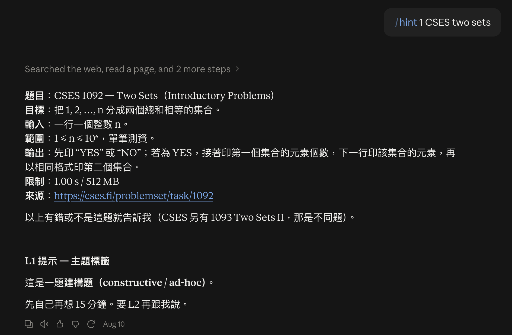

<div align="center">

# 🧩 cs-hint

**資工學習卡關時的分層提示協定**<br>
給最小可行的提示，而不是完整解答。

[](https://docs.claude.com/en/docs/agents-and-tools/agent-skills/overview)
[](LICENSE)
[](#)

[實際效果](#-實際效果) · [指令](#-指令) · [安裝](#-安裝) · [使用範例](#-使用範例)

</div>

---

> 直接看解答會給你「我看懂了」的錯覺，但**自己想出關鍵觀察**的能力並沒有長出來。
>
> cs-hint 讓 Claude 當一個**忍得住不講答案**的學長姐：一次只給一層提示，剩下的路你自己走。

**適用範圍**

| 類型 | 例子 |
|---|---|
| 🏆 競程 | Codeforces · AtCoder · LeetCode · CSES · UVa · 洛谷 · Kattis · ICPC |
| 💼 面試 | 演算法題、口述思路、follow-up |
| 📚 課程作業 | 資料結構 · 演算法 · 離散數學 · 計算理論 · OS／網路 lab |
| ✍️ 證明題 | 歸納、反證、歸約、pumping lemma |
| 🐛 除錯 | WA · TLE · RE · 跑不過 |

## 📸 實際效果

<p align="center">
  
</p>

<p align="center"><sub><code>/hint 1 CSES two sets</code>：先抓題目、用中性格式回報，只給 L1 主題就停下來。</sub></p>

## 🪜 四層提示

| 層級 | 演算法題 | 證明題 | 實作／系統題 |
|:---:|---|---|---|
| **L1** | 一個主題<br><sub>「區間 DP」「DSU」</sub> | 一個技巧<br><sub>「強歸納」「鴿籠」</sub> | 相關機制<br><sub>「copy-on-write」</sub> |
| **L2** | 你沒看到的那個性質 | 關鍵引理／不變量 | 卡住的設計決策 |
| **L3** | 狀態定義、架構、複雜度 | 證明骨架 | 模組劃分、pseudocode |
| **L4** | 完整解法 | 完整證明 | 完整實作 |

每層給完都會停下來，問你要不要下一層。

## 📝 指令

**分層提示**

| 指令 | 作用 |
|---|---|
| `/hint` | 預設流程：確認題目 → 問你試過什麼 → 從 L1 開始 |
| `/hint 1` · `/hint tag` | L1：只給方向 |
| `/hint 2` | L2：給關鍵觀察 |
| `/hint 3` | L3：給骨架 |
| `/hint 4` · `/hint full` | L4：完整解答 |

**工具**

| 指令 | 作用 |
|---|---|
| `/hint stress` | 對拍三件套：暴力解 + 測資產生器 + 比對腳本 |
| `/hint review` | AC 後檢討：code review、題型歸類、要不要收進模板 |
| `/hint lock` · `/hint unlock` | 🔒 比賽／考試模式：上鎖後拒絕一切提示 |

> [!TIP]
> 沒有 slash command 的環境，直接說「給我 L2」「再多一點提示」也可以。

## 🎯 設計重點

- **先讀真正的題敘**：不靠題號回憶題目，抓不到就請你貼上。
- **中性摘要**：回報題目時不偷渡提示，不會出現「n 很小，暗示可以暴力」這種話。
- **一次只給一層**：給完就停，絕不「順便」多講。
- **lock 沒有例外**：模擬賽中途問提示，這場練習就作廢了。

## 📦 安裝

<details open>
<summary><b>Claude.ai／Claude 桌面版</b></summary>

1. 到 [Releases](../../releases) 下載 `cs-hint.zip`
2. 打開 **Settings → Capabilities → Skills**，上傳 zip

</details>

<details>
<summary><b>Claude Code</b></summary>

```bash
git clone https://github.com/Raymond-Weng/cs-hint.git ~/.claude/skills/cs-hint
```

只想在單一專案啟用的話，改成 clone 到專案底下的 `.claude/skills/cs-hint`。

</details>

## 💡 使用範例

```text
/hint https://codeforces.com/problemset/problem/1850/D
```

```text
/hint 2 我用 DP 但轉移想不出來，dp[i] 表示前 i 個……
```

```text
/hint stress
（貼上你的程式碼）
```

---

<div align="center">
<sub>MIT License · 祝你 AC 🎈</sub>
</div>
